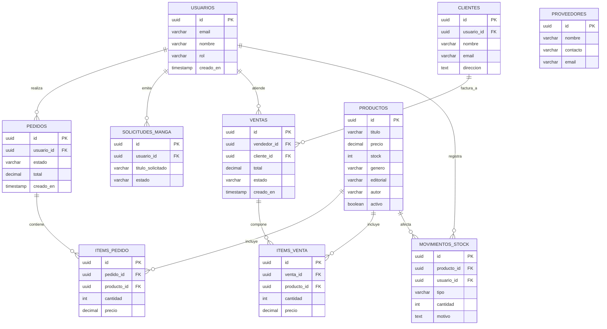
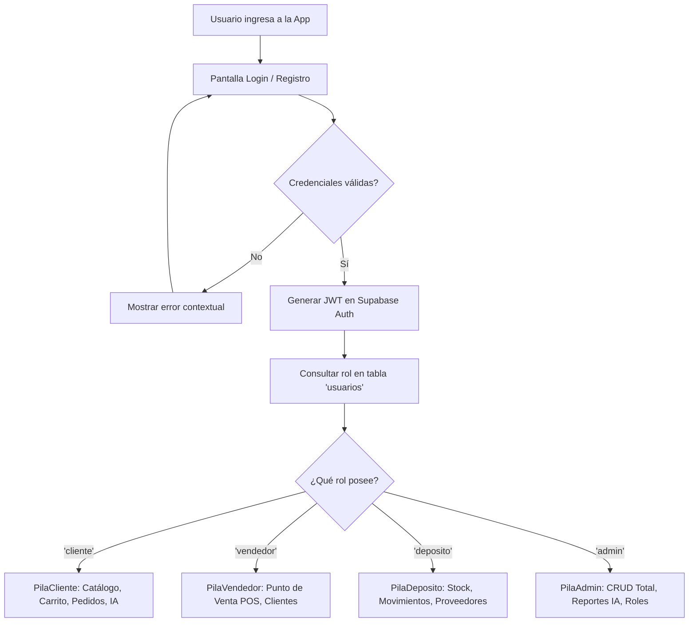
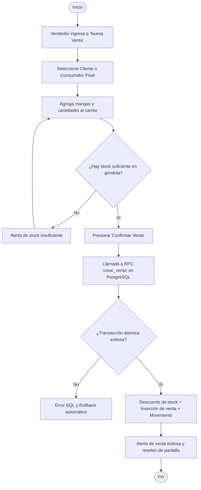
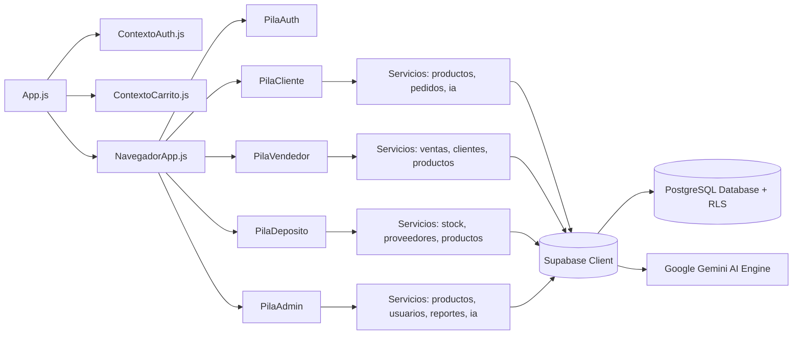

# Diagramas del Sistema — YORUMANGA

**Proyecto Integrador** — E.E.S.T N°1 de Esteban Echeverría  
**Materia:** Aplicaciones Móviles | **Profesor:** Pablo Gareis | **Curso:** 7° 3°  
**Alumnos:** Agustín Hermida y Elías González  

---

## 1. Diagrama Entidad-Relación (DER / Modelo Físico)

---

## 2. Casos de Uso — Autenticación y Enrutamiento por Rol

---

## 3. Diagrama de Actividades — Registro de Datos (Venta en Mostrador)

---

## 4. Diagrama de Componentes de la Arquitectura

