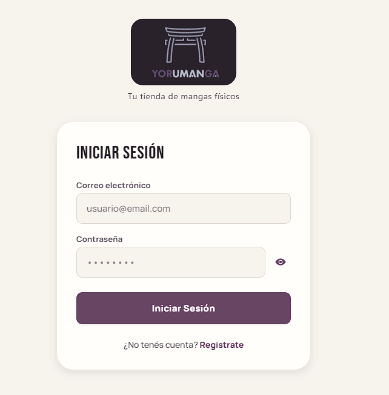
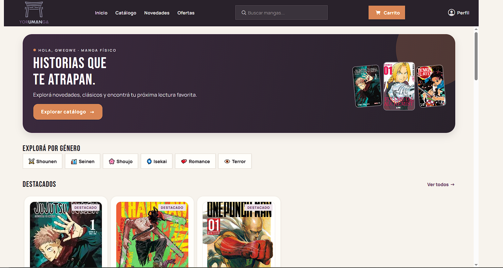
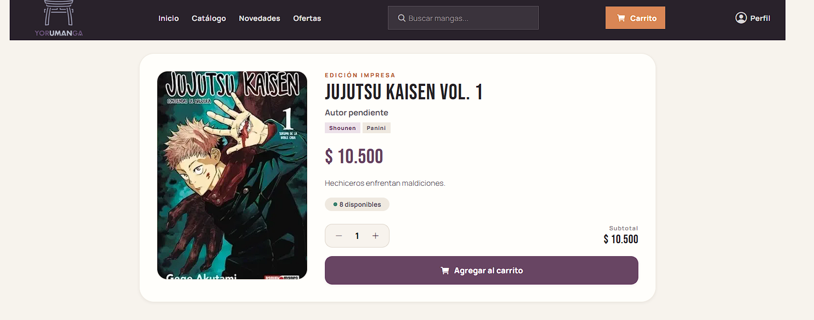
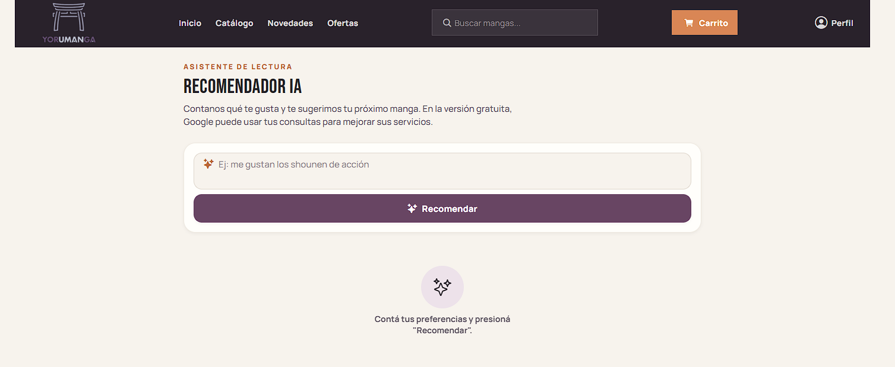
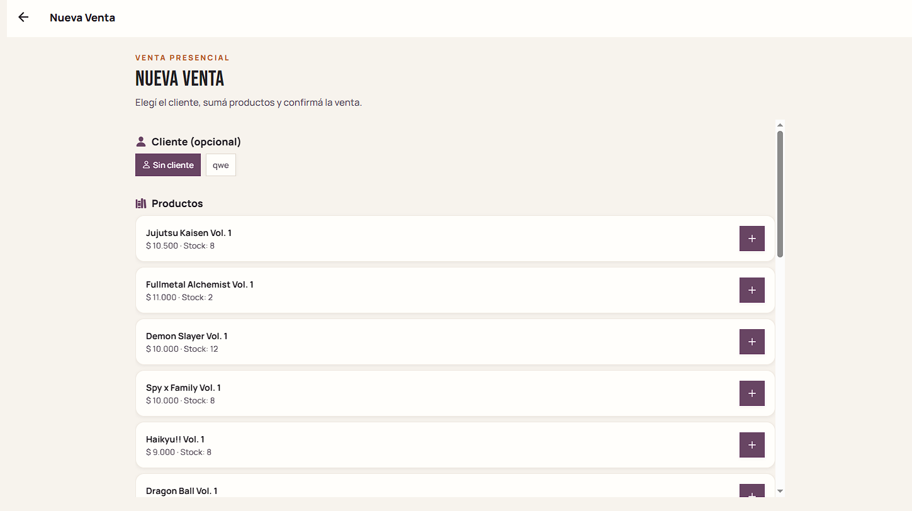
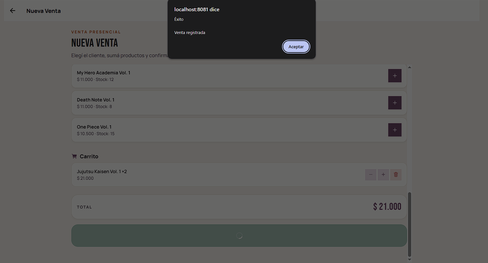
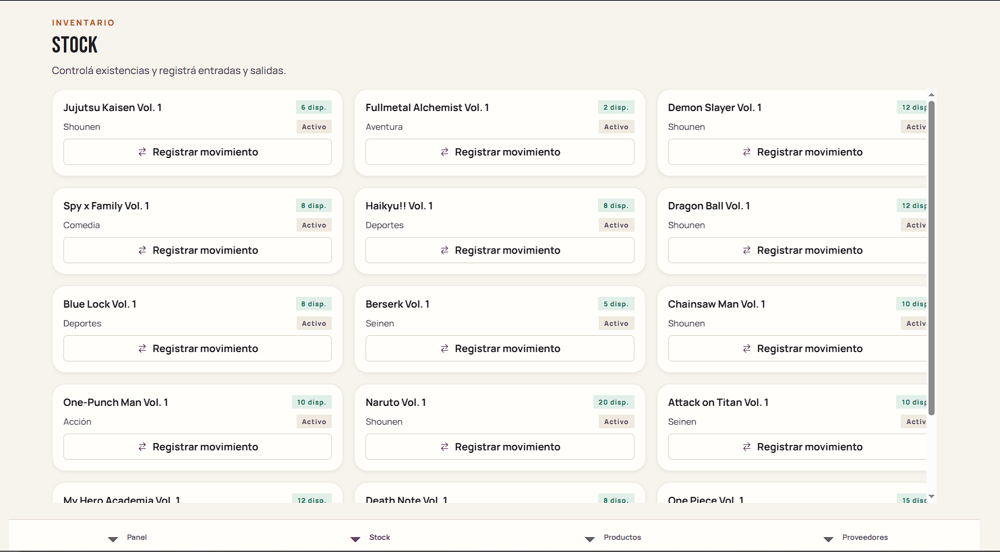
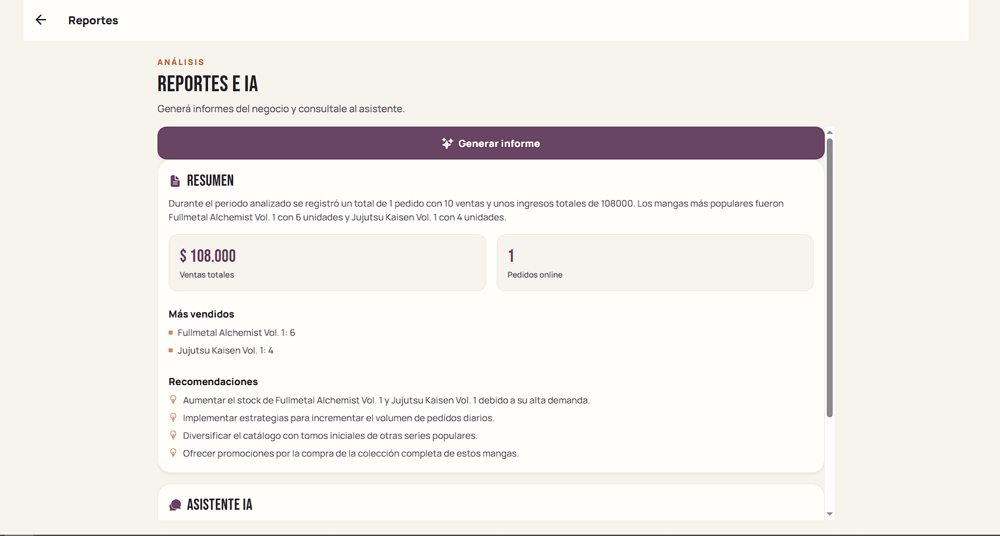

# MANUAL DE USUARIO DEL SISTEMA YORUMANGA
## Escuela de Educación Secundaria Técnica N°1 de Esteban Echeverría
**Materia:** Aplicaciones Móviles  
**Profesor:** Pablo Gareis  
**Curso:** 7° 3°  
**Autores:** Agustín Hermida y Elías González  

---

### Introducción al Manual
Este manual explica de manera sencilla, clara y ordenada cómo operar cada funcionalidad del sistema **YORUMANGA**. La aplicación adapta automáticamente sus menús y pantallas según el rol del usuario que haya iniciado sesión:
1. **Cliente** (público general / lectores)
2. **Vendedor** (empleado de salón y mostrador)
3. **Encargado de Depósito** (almacén, recepción y proveedores)
4. **Administrador** (supervisión, reportes e inventario general)

---

## 1. Módulo Común: Acceso al Sistema

### 1.1 Registro de una nueva cuenta
1. Al abrir la aplicación, en la pantalla de bienvenida presione **"Registrarse"** o **"Crear Cuenta"**.
2. Complete los siguientes campos:
   - **Nombre completo:** Ingrese su nombre y apellido.
   - **Correo electrónico:** Ingrese un email válido (ej. `nombre@correo.com`).
   - **Tipo de cuenta (Selección de Rol):** Seleccione mediante un toque el rol con el que desea ingresar al sistema:
     * **Cliente:** Para navegar el catálogo, agregar tomos al carrito y recibir recomendaciones.
     * **Vendedor:** Para atención en mostrador y registro de ventas físicas en el local.
     * **Depósito:** Para recepción de mercadería de proveedores y control de existencias.
     * **Admin:** Para acceso total al negocio, gestión de productos, roles y reportes con IA.
   - **Contraseña y Confirmación:** Ingrese una clave de al menos 6 caracteres (puede presionar el icono del ojo para revelar u ocultar el texto) y confírmela en el campo siguiente.
3. Presione el botón **"Crear cuenta"**. El sistema registrará el perfil en Supabase y asignará de forma instantánea el rol elegido.

### 1.2 Inicio de sesión (Login)
1. Ingrese su correo electrónico y contraseña registrados.
2. Presione el botón **"Ingresar"**.
3. El sistema verificará sus credenciales de forma segura y lo redirigirá a la pantalla principal correspondiente a su perfil.

---

## 2. Manual para el Rol: CLIENTE

### 2.1 Navegación y Búsqueda en el Catálogo
1. Desde la pantalla de **Inicio** o **Catálogo**, podrá visualizar todos los mangas disponibles con su portada, título, precio y stock.
2. Utilice la barra de búsqueda superior para encontrar un título o autor en particular.
3. Puede presionar sobre las etiquetas de categorías (ej. *Novedades ✨*, *Shounen ⚔️*, *Seinen 💀*, *Shoujo 🌸*, *Spokon ⚽*, *Ofertas 🏷️*) para filtrar instantáneamente el catálogo.
4. **Desplazamiento inmersivo (Scroll):** Al deslizar hacia abajo para ver más mangas, todo el bloque superior (título, buscador y fila de géneros) se desplaza suavemente hacia arriba para brindar mayor espacio visual a las portadas. Al deslizar levemente hacia arriba, los filtros reaparecen de inmediato.
5. Al presionar sobre un manga, accederá a la pantalla de **Detalle del Producto**, donde podrá leer la sinopsis completa, editorial y disponibilidad.

### 2.2 Uso del Carrito y Pasarela de Pago Simulada (Checkout)
1. En la ficha de cualquier manga disponible, presione el botón **"Agregar al Carrito"**.
2. Diríjase a la pestaña **Carrito** desde el menú inferior.
3. Podrá aumentar o disminuir las cantidades deseadas (el sistema le impedirá superar el stock real del local).
4. Verifique el subtotal calculado y presione el botón **"Proceder al Pago"**.
5. **Módulo Interactivo de Pago con Tarjeta (Inspirado en crd-ui):**
   - **Tarjeta 3D Dinámica:** Visualice la tarjeta en tiempo real con chip EMV dorado, ondas Contactless y detección automática de la marca (Visa, Mastercard, American Express, Cabal, Naranja).
   - **Giro Interactivo (Flip):** Al hacer foco en el campo CVV o presionar *"Ver dorso"*, la tarjeta gira suavemente en 3D revelando la banda magnética y el código de seguridad.
   - **Tarjetas de Prueba para Evaluación:** Cuenta con botones de acceso rápido que precargan tarjetas válidas de prueba (Visa Crédito o Mastercard Débito) con un solo toque para evaluar la experiencia de inmediato.
   - **Planes de Financiación:** Si selecciona *Tarjeta de Crédito*, elija entre 1 pago, 3 cuotas o 6 cuotas, todas sin interés, con cálculo automático. No se ofrecen otros planes.
   - **Validaciones en Vivo:** Control estricto de formato de tarjeta, nombre de titular en mayúsculas, expiración (MM/AA válido y futuro), código de seguridad y DNI.
6. Presione **"Pagar [Monto]"**. El sistema muestra una pausa de demostración: **no se conecta con ningún banco, no debita dinero ni aplica cifrado SSL propio**. Solo registra el pedido en la base de datos.
7. **Comprobante Digital de Compra:** Al confirmarse la simulación, se despliega el ticket con el código de operación único (ej. `#YORU-948201`), medio de pago enmascarado y monto total. El pedido se crea formalmente en la base de datos Supabase, se descuenta el stock y el carrito se vacía automáticamente. El comprobante es de control interno: no es una factura fiscal ni un recibo bancario.
8. Desde el comprobante puede presionar **"Ver en Mis Pedidos"** para realizar el seguimiento del despacho.

### 2.3 Recomendador con Inteligencia Artificial
1. Diríjase a la sección **"Recomendador IA"** en el menú del cliente.
2. Escriba en el cuadro de texto sus preferencias de lectura (por ejemplo: *"Busco un manga de peleas con demonios y toque cómico"* o *"Me gustan las historias de misterio y detectives"*).
3. Presione el botón **"Obtener Recomendaciones"**.
4. La Inteligencia Artificial analizará su pedido y le mostrará hasta 5 sugerencias precisas con su explicación de por qué le gustará, **garantizando que todos los títulos sugeridos tienen stock disponible para comprar en la tienda**.

### 2.4 Solicitud de Mangas no disponibles
1. Si busca un título que no se encuentra en el catálogo, ingrese a **"Solicitar Manga"**.
2. Escriba el nombre del título y observaciones opcionales (tomo o editorial deseada).
3. Presione **"Enviar Solicitud"**. La administración recibirá su pedido para coordinar la reposición con las distribuidoras.

---

## 3. Manual para el Rol: VENDEDOR

### 3.1 Registrar una Venta en Mostrador
1. Inicie sesión con su usuario de vendedor. Aparecerá en el panel de **Ventas**.
2. Presione el botón **"Nueva Venta"**.
3. Seleccione el cliente de la lista desplegable (o cree uno nuevo rápidamente con el botón *"+ Nuevo Cliente"*).
4. Seleccione los productos a vender indicando la cantidad deseada.
5. El sistema calculará el total en pesos automáticamente.
6. Presione **"Confirmar Venta"**.
7. En ese instante, el sistema:
   - Descuenta automáticamente el stock de la base de datos.
   - Genera el comprobante de venta interno.
   - Crea el movimiento de salida en el historial de depósito.

### 3.2 Gestión de Clientes
1. En la pestaña **Clientes**, presione **"Nuevo cliente"** (o use el acceso directo **"+ Nuevo cliente"** en la pantalla de Nueva Venta).
2. Es obligatorio completar el 100% de los campos:
   - **Nombre completo:** Nombre y apellido del comprador.
   - **Correo electrónico:** Debe pertenecer a un dominio popular válido (@gmail.com, @hotmail.com, @outlook.com, @yahoo.com).
   - **Dirección:** Domicilio para entregas o facturación.
3. Al guardar, el cliente queda registrado y disponible al instante para asociarlo a las ventas en mostrador.

---

## 4. Manual para el Rol: ENCARGADO DE DEPÓSITO

### 4.1 Control y Visualización de Stock
1. Al ingresar, el panel de **Stock** muestra todos los artículos con sus existencias numéricas.
2. Los artículos sin stock o con pocas unidades aparecerán con alertas visuales destacadas para su reposición inmediata.

### 4.2 Registro de Movimientos (Entrada y Salida de Mercadería)
1. Para registrar el ingreso de mercadería entregada por un proveedor:
   - Ingrese a **"Movimiento de Stock"**.
   - Seleccione el producto correspondiente.
   - Seleccione el tipo de movimiento: **Entrada** (compra a proveedor) o **Salida** (rotura/devolución).
   - Indique la cantidad y detalle el motivo en el campo observaciones (ej. *"Recepción Factura Ivrea N° 4580"*).
   - Presione **"Guardar Movimiento"**.
2. El stock se sumará al inventario y el movimiento quedará guardado para auditoría.

### 4.3 Gestión de Proveedores
1. En la pestaña **Proveedores**, presione **"Nuevo Proveedor"** (o seleccione uno existente para editarlo).
2. Es obligatorio completar el 100% de los campos:
   - **Proveedor:** Nombre de la empresa o editorial distribuidora.
   - **Persona de Contacto:** Nombre y apellido del asesor comercial o distribuidor.
   - **Correo electrónico:** Debe tener formato válido terminado en `.com` o `.com.ar` y pertenecer a un dominio reconocido (ej: `@gmail.com`, `@hotmail.com`, `@outlook.com`).
   - **Dirección:** Domicilio fiscal o del depósito central.
3. Presione **"Crear proveedor"**. El sistema validará que ningún campo quede vacío antes de guardar el registro en la base de datos.

---

## 5. Manual para el Rol: ADMINISTRADOR

### 5.1 Panel General y Gestión de Catálogo
1. El Administrador cuenta con acceso total a todos los módulos.
2. En la sección **Productos**, puede:
   - Dar de alta nuevos mangas completando título, género, autor, editorial, precio y stock inicial.
   - Modificar precios o descripciones.
   - Activar o desactivar títulos del catálogo público.

### 5.2 Control de Pedidos y Solicitudes
1. En **Pedidos**, puede ver las órdenes generadas por los clientes online y cambiar su estado a *"En Proceso"* o *"Completado"* cuando el cliente retira su paquete.
2. En **Solicitudes**, visualiza los mangas pedidos por los usuarios para coordinar compras futuras con las editoriales.

### 5.3 Informes y Reportes con Inteligencia Artificial
1. Ingrese a la pestaña **Reportes**.
2. Podrá visualizar estadísticas numéricas consolidadas: recaudación total, cantidad de pedidos y los tomos más vendidos.
3. Presione el botón **"Generar Informe con IA"**.
4. La Inteligencia Artificial redactará un informe ejecutivo completo con diagnóstico de ventas y recomendaciones de compras y promociones para los próximos días.

### 5.4 Administración de Usuarios y Roles
1. En el módulo **Usuarios**, el Administrador puede ver todo el personal registrado y modificar roles (ej. ascender un cliente a vendedor o encargado de depósito) mediante funciones protegidas de base de datos.
