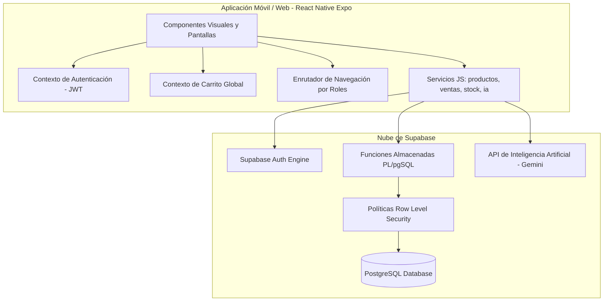
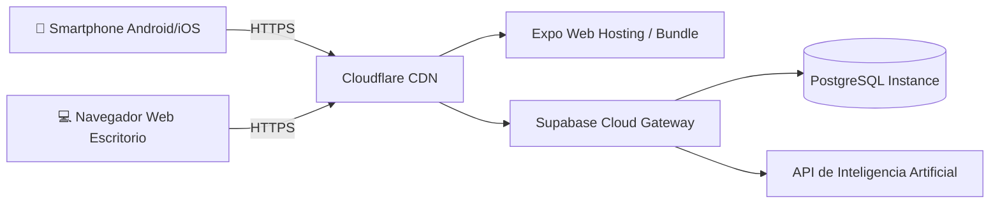
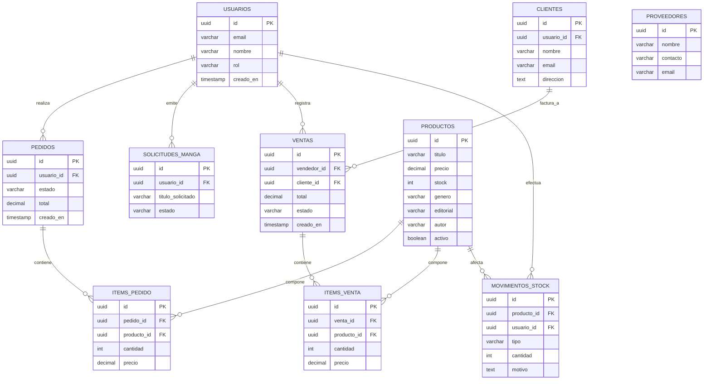

# ESCUELA DE EDUCACIÓN SECUNDARIA TÉCNICA N°1 DE ESTEBAN ECHEVERRÍA
### TECNICATURA EN INFORMÁTICA PERSONAL Y PROFESIONAL
**Materia:** Aplicaciones Móviles  
**Profesor:** Pablo Gareis  
**Curso / División:** 7° 3°  
**Ciclo Lectivo:** 2026  

---

# PROYECTO INTEGRADOR: DESARROLLO DE UN SISTEMA DE SOFTWARE
## Sistema Integral de Gestión, Venta y Recomendación IA: YORUMANGA

**Integrantes del Equipo de Desarrollo:**
* **Agustín Hermida** — *Responsable de Backend, Servidor (Supabase), Base de Datos, Autenticación e Inteligencia Artificial.*
* **Elías González** — *Responsable de Frontend, Diseño Visual (UI/UX), Navegación, Pruebas y Documentación.*

**Repositorio Oficial en GitHub:** [https://github.com/Raziiel08/yorumanga](https://github.com/Raziiel08/yorumanga)  
*(Ramas activas de trabajo: `main`, `Documentacion`, `Marketing`)*

---

# 1. Introducción

### 1.1 Descripción general
**YORUMANGA** es una plataforma tecnológica integral diseñada para resolver la problemática de gestión comercial, logística y de atención al cliente de una tienda física y comercio electrónico especializado en mangas japoneses, novelas ligeras y merchandising coleccionable. 

El sistema combina una aplicación móvil y de escritorio desarrollada con **React Native (Expo)**, un servidor y base de datos relacional en la nube provisto por **Supabase (PostgreSQL, Supabase Auth y Row Level Security - RLS)**, y servicios de **Inteligencia Artificial generativa** para la recomendación inteligente de lecturas y la emisión de reportes ejecutivos.

La plataforma reemplaza por completo el uso de planillas de cálculo de Excel desarticuladas, ofreciendo un entorno multiusuario seguro con cuatro perfiles de acceso claramente delimitados: **Cliente**, **Vendedor de Salón**, **Encargado de Depósito** y **Administrador**.

### 1.2 Propósito
El propósito fundamental del sistema es:
1. Eliminar los errores humanos de sobreventa y quiebres de stock mediante transacciones atómicas en el servidor.
2. Agilizar los tiempos de atención en el mostrador del local comercial.
3. Centralizar el registro de compras, pedidos y proveedores.
4. Mejorar la experiencia del usuario facilitando el descubrimiento de nuevos mangas mediante algoritmos de IA adaptados a sus gustos.

### 1.3 Alcance
* **Dentro del alcance (Qué sí realiza el sistema):**
  - Autenticación de usuarios mediante correo y contraseña con perfiles (Cliente, Vendedor, Depósito o Administrador). El registro público crea cuentas de cliente; los demás roles se gestionan internamente (pendiente de restricción, ver informe de testing).
  - Catálogo virtual interactivo clasificado por géneros (Shounen, Seinen, Shoujo, Spokon, Isekai, etc.), Novedades, Ofertas y navegación con ocultamiento dinámico de filtros al scrollear hacia abajo.
  - Carrito de compras y checkout interactivo de demostración con tarjeta 3D (detección de marca Visa, Mastercard, Amex, Cabal y Naranja; 1, 3 o 6 cuotas sin interés y comprobante digital interno). No hay pasarela bancaria real.
  - Módulo de Punto de Venta (POS) en mostrador para vendedores con cálculo automático de totales y descuento en tiempo real.
  - Administración de inventario en bodega: altas/bajas de tomos, entradas por recepción de proveedores y auditoría de movimientos.
  - Módulo de solicitudes especiales para títulos de manga que no se encuentren en el catálogo.
  - Asistente inteligente de recomendaciones para clientes según sus preferencias temáticas.
  - Generador de reportes estadísticos e informes comerciales estratégicos para la gerencia con IA.
* **Fuera del alcance (Qué no realiza en esta primera etapa):**
  - Facturación fiscal electrónica directa vinculada a la AFIP (se emite comprobante de control interno homologado académicamente).
  - Cobro bancario con débito de dinero real: el checkout solo simula la experiencia de pago y valida formatos; no se conecta con bancos, no debita fondos y no realiza verificaciones criptográficas propias.

### 1.4 Objetivos de la documentación
- Brindar una especificación clara y rigurosa de los requisitos funcionales, no funcionales y de arquitectura del proyecto.
- Facilitar el mantenimiento, escalabilidad y comprensión del código para cualquier desarrollador.
- Documentar las pruebas de software (positivas, negativas y límite) y los protocolos de seguridad.
- Registrar el diseño de marketing, identidad institucional y maquetación física 3D del local comercial.

---

# 2. Descripción del Sistema

### 2.1 Objetivo del sistema
Proporcionar a YORUMANGA una herramienta digital multiplataforma (móvil y web) que garantice el control estricto del inventario, acelere las ventas y permita la toma de decisiones informada mediante analítica asistida por IA.

### 2.2 Stakeholders (Interesados del sistema)
- **Clientes:** Usuarios lectores que utilizan la app para explorar títulos, encargar pedidos y recibir recomendaciones.
- **Vendedor:** Empleado del salón de ventas que cobra en caja, atiende clientes y registra ventas presenciales.
- **Encargado de Depósito:** Responsable del almacenamiento, recepción de bultos de editoriales y control de mermas.
- **Administrador:** Dueño del negocio que supervisa métricas globales, precios, catálogo y permisos del personal.
- **Proveedores / Editoriales (Externos):** Empresas proveedoras (Ivrea, Panini Manga, Ovni Press, Distrito Manga).

### 2.3 Funciones principales
1. **Módulo de Usuarios y Seguridad:** Control de acceso estricto y vistas según rol.
2. **Módulo de Catálogo y Búsqueda:** Exploración en cuadrícula y detalle con sinopsis, portada y stock en vivo.
3. **Módulo de Carrito y Checkout de Demostración:** Interfaz interactiva de tarjeta 3D (giro frente/dorso, chip EMV, detección dinámica de marca Visa/Mastercard/Amex/Cabal/Naranja), 1/3/6 cuotas sin interés, validación en tiempo real y comprobante interno. Sin cobro real ni pasarela bancaria.
4. **Módulo de Ventas Transaccionales:** Procedimiento en base de datos que descuenta stock y registra la venta de manera atómica.
5. **Módulo de Depósito y Proveedores:** Entrada y salida de mercadería con justificación y libreta de proveedores.
6. **Módulo de Inteligencia Artificial:** Recomendador temático para clientes y redactor de resúmenes comerciales para la administración.

### 2.4 Restricciones generales
- Requiere conexión a Internet para sincronizar operaciones con la nube de Supabase.
- Ninguna regla de negocio crítica puede depender únicamente del frontend; el servidor valida y hace cumplir las restricciones.
- Las contraseñas deben tener como mínimo 6 caracteres y estar hasheadas criptográficamente.

---

# 3. Arquitectura del Sistema

### 3.1 Estilo arquitectónico
Se adoptó una arquitectura **BaaS (Backend as a Service) desacoplada**, con una aplicación cliente enriquecida (Thick Client) en React Native/Expo conectada a través de protocolos seguros (HTTPS/WSS) con la plataforma Supabase (PostgreSQL + Auth + Edge Functions). La Edge Function de IA está implementada en `supabase/funciones/ai/logica.js`, con variables y funciones en español (con `index.js` como punto de entrada): recibe `recommend`, `report` y `chat`, y mantiene la clave de Gemini solo en el servidor.

### 3.2 Componentes principales
- **Capa Visual (Frontend):** Diseñada con componentes reutilizables (`Boton`, `Campo`, `TarjetaProducto`, `TarjetaCreditoInteractiva`, `EncabezadoPantalla`, `AvisoError`) con soporte responsivo para móviles y navegadores web.
- **Capa de Lógica de Negocio (Servidor):** Funciones PL/pgSQL en base de datos (`crear_venta`, `crear_pedido`, `registrar_movimiento_stock`) que aseguran la atomicidad transaccional (ACID).
- **Capa de Persistencia:** Base de datos relacional PostgreSQL con restricciones estrictas y disparadores (triggers).

### 3.3 Diagrama de despliegue

### 3.4 Escalabilidad y rendimiento
- Consultas optimizadas con índices B-Tree en campos de búsqueda (`titulo`, `genero`, `activo`).
- Empaquetado optimizado del frontend (menos de 1.7 MB de bundle web).
- Respuestas del backend en menos de 100 milisegundos gracias al alojamiento distribuido de Supabase.

---

# 4. Diseño de Datos

### 4.1 Diagrama Entidad-Relación (DER)

### 4.2 Descripción de entidades
1. **usuarios:** Usuarios registrados en el sistema, vinculados a `auth.users` mediante UUID, con su correspondiente rol (`cliente`, `vendedor`, `deposito`, `admin`).
2. **productos:** Catálogo de títulos de manga con título, autor, editorial, género, precio, stock disponible y estado de visibilidad.
3. **clientes:** Libreta de clientes para facturación en mostrador presencial.
4. **proveedores:** Datos de las editoriales mayoristas de distribución.
5. **pedidos & items_pedido:** Estructura cabecera-detalle de las compras realizadas por clientes desde la tienda en línea.
6. **ventas & items_venta:** Estructura cabecera-detalle de las ventas efectuadas por el vendedor en el mostrador del local.
7. **movimientos_stock:** Bitácora histórica inmutable de entradas (recepción de mercadería) y salidas (mermas, averías o ajustes de inventario).
8. **solicitudes_manga:** Registro de pedidos especiales solicitados por clientes para títulos faltantes.

### 4.3 Reglas de integridad
- **Regla de No Negatividad:** `CHECK (stock >= 0)` y `CHECK (precio >= 0)`.
- **Integridad Transaccional:** La función `crear_venta` valida que `stock >= cantidad` para todos los productos del carrito antes de descontar una sola unidad. Si falta stock en un solo ítem, la operación completa es rechazada (Rollback).
- **Protección Histórica de Precios:** Los precios se guardan en el ítem de venta/pedido en el momento exacto de la transacción para no alterar balances si el precio del producto cambia en el futuro.

### 4.4 Migración y respaldo
- El esquema se crea y mantiene a través del archivo idempotente `supabase/basededatos.sql`.
- Supabase realiza copias de seguridad automáticas y recuperación puntual ante contingencias.

---

# 5. Comportamiento del Sistema

### 5.1 Escenarios principales
- **Escenario 1 (Compra Online por Cliente con Pasarela de Pago Simulada):**
  Inicio de sesión -> Búsqueda en catálogo -> Detalle del producto -> Agregar al carrito -> Revisión del pedido -> Proceder al Pago -> Pasarela interactiva de tarjeta (3D Flip / Cuotas) -> Autorización bancaria simulada -> Emisión de comprobante digital de compra -> Descuento automático de stock -> Estado del pedido: "Pendiente".
- **Escenario 2 (Venta en Mostrador por Vendedor):**
  Inicio de sesión en terminal -> Menú "Nueva Venta" -> Selección del cliente -> Agregar productos y cantidades -> Totalización automática -> Confirmar cobro -> Generación de venta, detalle y movimiento de stock.
- **Escenario 3 (Recepción de Mercadería por Depósito):**
  Ingreso a módulo Stock -> Selección del producto -> Opción "Ingresar Stock" -> Ingreso de cantidad y motivo -> Actualización instantánea en el catálogo público.

### 5.2 Inicio de sesión
Al autenticarse mediante email y contraseña, Supabase Auth devuelve un token JWT. La aplicación consulta el rol del usuario en la tabla `usuarios` y redirecciona a la interfaz exclusiva del rol:
- Si el rol es `cliente`, se monta la pila `PilaCliente`.
- Si el rol es `vendedor`, se monta la pila `PilaVendedor`.
- Si el rol es `deposito`, se monta la pila `PilaDeposito`.
- Si el rol es `admin`, se monta la pila `PilaAdmin`.

### 5.3 Validaciones
- **Correos electrónicos:** Formato estricto que exige '@', terminación obligatoria en '.com' (o '.com.ar') y validación de dominios populares reconocidos (ej. @gmail.com, @hotmail.com, @outlook.com, @yahoo.com).
- **Formularios de proveedores y clientes:** Exigencia obligatoria del 100% de los campos (Nombre, Contacto, Correo válido y Dirección).
- **Contraseñas:** Longitud mínima de 6 caracteres con verificación de coincidencia en el registro.
- **Validación de stock:** Control transaccional en servidor para impedir cantidades negativas o mayores a las existencias.

### 5.4 Manejo de errores
- Mensajes contextuales claros con el componente `AvisoError.js`.
- Los errores originados en el servidor SQL son capturados y transformados en advertencias legibles para el operador (ej. *"No hay suficiente stock para Dragon Ball Super Tomo 1"*).

---

# 6. Restricciones del Diseño

### 6.1 Compatibilidad
- Móviles Android 8.0 o superior / iOS 13 o superior.
- Navegadores web de escritorio: Chrome, Firefox, Edge, Safari.

### 6.2 Rendimiento
- Carga de catálogo en menos de 2 segundos.
- Navegación fluida a 60 FPS mediante React Navigation nativo.

### 6.3 Seguridad
- Políticas RLS (Row Level Security) activadas en todas las tablas para evitar que un usuario manipule registros ajenos.
- Las comunicaciones con Supabase se realizan por HTTPS/TLS propio del proveedor; la app no implementa cifrado propio y el checkout no contacta a entidades bancarias.

### 6.4 Normativas aplicables
- Principio de confidencialidad y resguardo de datos personales de los clientes.

### 6.5 Limitaciones tecnológicas
- Necesidad de acceso a Internet para la persistencia de las operaciones.

---

# 7. Pruebas y Validaciones

### 7.1 Pruebas unitarias
Comprobación de algoritmos de cálculo de totales, formateadores de moneda argentina (`moneda.js`) y validaciones de datos de entrada.

### 7.2 Pruebas de integración
Verificación del flujo completo entre el cliente móvil, las funciones RPC de Supabase y el descuento atómico de stock.

### 7.3 Pruebas de funcionalidades web
Compilación y prueba del paquete web de producción (`npx expo export --platform web`), validando que la interfaz se adapte con teclado y mouse.

### 7.4 Pruebas del frontend
Validación de estados de carga (`ActivityIndicator`), botones deshabilitados durante peticiones y avisos flotantes de error.

### 7.5 Criterios de aceptación (Matriz de Casos de Prueba)

La matriz completa y actualizada de **31 casos (CP01–CP31)** se mantiene en [`docs/PRUEBAS.md`](PRUEBAS.md), única fuente de verdad. En este informe solo se resume su cobertura para no duplicar ni desincronizar la numeración:

| Bloque | Casos | Cobertura |
|:---|:---:|:---|
| Autenticación y registro | CP01–CP08 | Login, contraseñas y validación de correos |
| Ventas y pedidos | CP09–CP13 | Mostrador, carrito y reserva de stock |
| Operaciones y seguridad | CP14–CP20 | Proveedores, clientes, movimientos y RLS |
| Checkout de demostración y catálogo | CP21–CP25 | Tarjeta 3D, cuotas, comprobante y scroll |
| Inteligencia Artificial | CP26–CP31 | CORS, sesión, tipos, recomendación, informes y chat |

Los casos CP01–CP25 son de ejecución manual y no están automatizados. Los casos CP26–CP31 están automatizados con `npm run test:ai` (**6 passed / 0 failed**) y se ejecutan con Gemini y Supabase simulados. Las entradas, resultados esperados y obtenidos de cada caso se consultan en `docs/PRUEBAS.md`.

---

# 8. Despliegue y Operación

### 8.1 Entorno de desarrollo
- Sistema Operativo: Windows 10/11.
- Entorno de ejecución: Node.js v20+, Expo SDK 51.
- Editor y asistentes: VS Code, OpenCode y Antigravity.
- Variables de entorno locales configuradas en `.env`.

### 8.2 Entorno de producción
- Servidor Cloud de Supabase con motor PostgreSQL administrado.
- Variables de entorno protegidas para las claves públicas y de servicio.

### 8.3 Publicación del sistema
- **Web:** Exportación estática optimizada lista para plataformas de hosting como Vercel o Netlify.
- **Android:** Generación de paquete APK instalable mediante EAS Build.

### 8.4 Monitoreo
- Panel central de Supabase para seguimiento de consumo de CPU, latencia de base de datos y logs de autenticación.

### 8.5 Mantenimiento
- Control de versiones estructurado mediante Git con políticas de ramas independientes (`main`, `Documentacion`, `Marketing`).

---

# 9. Ciclo de Vida del Software

### 9.1 Análisis de requisitos
Relevamiento exhaustivo del funcionamiento tradicional de comiquerías y librerías físicas, identificando los problemas de sincronización de stock entre el mostrador físico y las ventas por internet.

### 9.2 Diseño
Diseño visual centrado en la usabilidad y la estética propia de la cultura del cómic japonés, complementado con normalización de bases de datos relacionales en 3ª Forma Normal.

---

# 10. Sector de Marketing e Identidad Institucional

### 10.1 Identidad general de la empresa
* **Nombre Comercial:** YORUMANGA.
* **Etimología del nombre:** La palabra *Yoru* (夜) significa "Noche" en idioma japonés. El concepto evoca el momento de desconexión y tranquilidad en el que los lectores y coleccionistas se sumergen en la lectura de sus historias favoritas al terminar su jornada.
* **Misión:** Acercar la cultura del manga japonés y el coleccionismo a la comunidad juvenil y adulta, brindando una experiencia de compra integral que une la calidez del local físico tradicional con la comodidad y personalización de nuestra tecnología digital.
* **Visión:** Consolidarse como la tienda de manga y cafetería temática de referencia en la zona sur y el área metropolitana de Buenos Aires, reconocida por la variedad de catálogo, velocidad de reposición y atención personalizada potenciada por Inteligencia Artificial.
* **Valores:** Pasión por el cómic, honestidad comercial, innovación tecnológica, inclusión comunitaria y respeto por el coleccionista.

### 10.2 Lugar físico de la empresa
* **Dirección elegida:** Av. Corrientes 1845, Ciudad Autónoma de Buenos Aires.
* **Distribución arquitectónica (120 m² en dos plantas):**
  - **Planta Baja (80 m²):** Mostrador de atención y cobro con terminal POS, bateas centrales de exposición de mangas clasificados por género, vitrinas iluminadas con merchandising y rincón temático de lectura y cafetería.
  - **Planta Alta (40 m²):** Depósito y almacén con estanterías industriales codificadas, sector de empaquetado para envíos online y puesto administrativo.

### 10.3 Triangulación de medios de transporte y ubicación
Ubicación estratégica seleccionada para maximizar la afluencia de público:
- **Subterráneo:** A 150 metros de la Estación Callao (Línea B) y a 300 metros de la Estación Congreso (Línea A).
- **Líneas de Colectivo:** Acceso a más de 18 líneas metropolitanas (6, 12, 24, 26, 37, 50, 60, 115, 124, 146, 150, 180).
- **Conexión Interurbana:** Conexión ágil hacia las estaciones cabeceras de trenes de Once, Retiro y Constitución.

### 10.4 Isotipo
El isotipo de Yorumanga representa un tomo de manga abierto estilizado cuyas páginas forman la silueta sutil de una luna creciente nocturna combinada con los marcos geométricos de las viñetas del cómic japonés.

### 10.5 Logotipo
Composición tipográfica en mayúsculas de alto impacto en tipografía **Bebas Neue**, transmitiendo fuerza y presencia visual, acompañada del descriptor de marca en tipografía **Manrope Regular**.

### 10.6 Círculo cromático y paleta institucional
La paleta oficial fue extraída directamente de la configuración del sistema (`src/constants/theme.js`):
- **Púrpura Manga (Primario):** `#684563` — Transmite sofisticación, fantasía e identidad editorial.
- **Sombra Nocturna (Primario Oscuro):** `#29222B` — Proporciona contraste y estructura a los encabezados.
- **Lila Crepúsculo (Primario Claro):** `#936E89` — Utilizado para bordes y tarjetas secundarias.
- **Naranja Shounen (Acento):** `#D98655` — Transmite energía, dinamismo y destaca ofertas y botones de compra.
- **Fondo Pergamino:** `#F7F3ED` — Fondo cálido que simula las páginas de un tomo físico para descanso visual.
- **Blanco Superficie:** `#FFFEFB` — Superficie limpia para tarjetas de producto y cuadros de diálogo.
- **Tinta Negra (Texto):** `#29252A` — Para legibilidad óptima en descripciones y textos.

### 10.7 Productos
- Mangas traducidos y oficiales de editoriales líderes: Shounen, Seinen, Shojo, Spokon, Isekai, Terror y Clásicos.
- Novelas ligeras (Light Novels) y libros de arte (Artbooks).
- Protectores de tomos y fundas de polipropileno para coleccionistas.

### 10.8 Merchandising
- **Remeras y Buzos estampados:** Indumentaria de algodón peinado con el logo de Yorumanga en serigrafía minimalista.
- **Tazas térmicas y Mugs de cerámica:** Con el isotipo institucional y viñetas de manga.
- **Tote Bags ecológicas:** Bolsas de lienzo reutilizables para la entrega de compras en el local.
- **Stickers vinílicos coleccionables:** Obsequiados a los clientes con cada compra.

### 10.9 Diversas aplicaciones del logo
- **Fondo Claro:** Isotipo púrpura institucional sobre fondo blanco o pergamino.
- **Fondo Oscuro:** Isotipo en naranja vibrante con tipografía blanca para cartelería exterior nocturna.
- **Versión Monocromática:** Aplicable a tickets térmicos de caja e impresiones en una sola tinta.
- **Favicon y App Icon:** Isotipo centrado con fondo oscuro para la pantalla de inicio de celulares.

### 10.10 Estudio de identidad visual
A diferencia de las comiquerías tradicionales cargadas de elementos caóticos, Yorumanga proyecta una imagen limpia y moderna inspirada en las librerías japonesas de Tokio (concepto *Tsutaya Bookstore*), logrando un entorno donde el manga es tratado con el valor cultural y visual que merece.

### 10.11 Manual de identidad / Manual de usuario
- **Manual de Identidad:** Regula el área de seguridad obligatoria alrededor del logo (mínimo el 50% de la altura de la letra inicial), tamaños mínimos de impresión (25 mm) y prohibición de alterar las proporciones originales.
- **Manual de Usuario:** Guía instructiva para que cada perfil (Cliente, Vendedor, Depósito y Administrador) opere con soltura cada pantalla del software.

### 10.12 Tríptico informativo
Folleto institucional plegable en tres cuerpos (A4 apaisado):
- **Cuerpo Exterior:** Portada con logo, eslogan, horarios de atención, mapa y redes sociales.
- **Cuerpo Interior:** Breve reseña de la tienda, catálogo destacado por géneros, beneficios del café de lectura y código QR para descargar la app.

### 10.13 Códigos QR de los sectores
El sistema cuenta con códigos QR generados que se ubican en carteles acrílicos en cada sector del local físico:
1. **QR Mostrador / Acceso a la App:** Permite a los clientes escanear y acceder inmediatamente al catálogo móvil en su propio celular.
2. **QR Bateas de Mangas (Recomendador IA):** Ubicado en los pasillos de mangas para que el cliente consulte recomendaciones inteligentes de tomos disponibles mientras recorre las bateas.
3. **QR Sector Café / Solicitud de Mangas:** En las mesas de la cafetería para consultar la carta y enviar solicitudes de títulos agotados.

---

### 10.14 Maquetado físico — Sweet Home 3D

> **¿Qué es Sweet Home 3D?**  
> Es un software de diseño arquitectónico gratuito y de código abierto que permite dibujar el plano de un local en 2D (con medidas en metros, paredes, puertas y ventanas) y visualizarlo instantáneamente en una maqueta tridimensional interactiva (3D) con muebles, iluminación y texturas reales.

#### Especificación del Plano del Local Comercial Yorumanga:
* **Dimensiones generales:** 8.00 metros de ancho por 15.00 metros de largo (superficie de 120 m² en planta baja y entrepiso).
* **Zonificación y Medidas:**
  1. **Salón de Ventas Principal (Frente - 8.00 m x 9.00 m):**
     - Puerta vidriada de doble hoja con rampa de acceso reglamentaria (1.20 m de ancho).
     - Bateas y exhibidores centrales de 1.20 m de altura para no obstruir la visión general del salón.
     - Pasillos de circulación de 1.40 m de ancho para garantizar accesibilidad universal.
     - Estanterías perimetrales de madera clara y herrería negra de 2.20 m de alto contra las paredes laterales, con iluminación LED cálida.
  2. **Punto de Venta y Mostrador (Sector derecho - 3.00 m x 2.00 m):**
     - Mostrador en forma de 'L' con terminal táctil conectada a la aplicación Yorumanga, lector de código de barras y área de cobro y despacho.
  3. **Rincón de Lectura y Cafetería (Fondo izquierdo - 5.00 m x 4.00 m):**
     - 4 mesas redondas con sillas ergonómicas, rincón de sillones individuales y barra de cafetería con máquina de café expreso.
  4. **Depósito y Logística (Planta Alta / Entrepiso - 8.00 m x 4.00 m):**
     - Acceso por escalera reforzada con baranda metálica.
     - Estanterías industriales metálicas de alta resistencia para acopio clasificado por editorial y mesa de embalaje.

### 10.16 Integración del sector
La arquitectura física del salón de ventas, el diseño del merchandising y la interfaz digital de la aplicación móvil forman un ecosistema coherente y sincronizado:
- La misma paleta cromática (`#684563` Púrpura Manga y `#D98655` Naranja Acento) se refleja en las paredes, uniformes del personal y en los botones de la aplicación.
- Los códigos QR distribuidos en el salón físico guían al cliente directamente hacia las funciones clave del sistema informático, creando una experiencia omnicanal moderna y profesional.

---
*Documento técnico formal preparado para su presentación, defensa y aprobación académica.*
